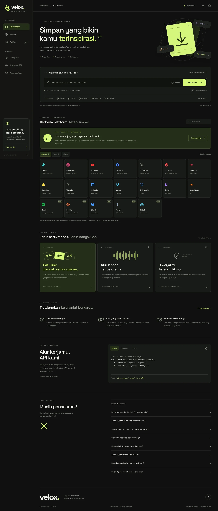
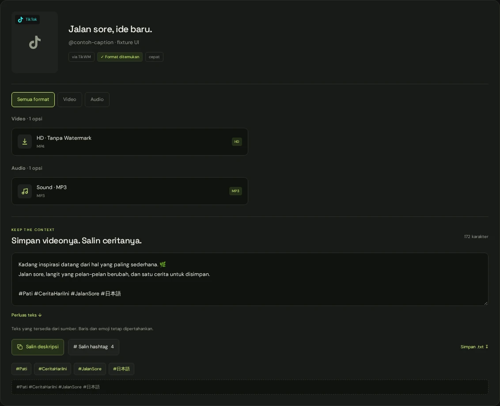

# VELOX Studio 2.2

**Simpan yang bikin kamu terinspirasi.**

Redesign menyeluruh dari project `velox-dl-max-redesigned.zip`: workspace downloader bernuansa charcoal + lime, tipografi editorial, micro-interaction, serta tema terang. Dibangun dengan HTML, CSS, vanilla JavaScript, dan Express. Tidak ada build frontend atau CDN UI yang wajib diakses.



## Baru di 2.2: scrapr + simpan konteks

Desain Studio tetap dipertahankan, dengan **19 integrasi**. Adaptasi terpilih dari [coflyn/scrapr](https://github.com/coflyn/scrapr) hanya dipasang pada Spotify, Reddit, dan Bilibili. **13 file resolver/engine lama, termasuk TikTok, Instagram, dan YouTube, identik dengan rilis 2.1**; hash baseline diuji otomatis. Normalizer/dispatcher mendapat metadata teks tambahan tanpa mengubah format unduhan lama.

| Platform | Jalur saat ini | Batasan penting |
|---|---|---|
| Spotify | Spotisaver → SpotiDown → Spotimate → info/preview resmi | Audio pihak ketiga untuk link track, bukan jaminan file asli Spotify atau bitrate tertentu. Album/playlist tetap info koleksi. |
| Reddit | API publik → RapidSave → yt-dlp | Audio mengikuti file sumber; video bisa tanpa suara. |
| Bilibili | API langsung adaptasi scrapr → yt-dlp | BV/AV mainland dan `p=`; kualitas sesuai respons API, multipart diberi label bagian. |
| Bluesky | API publik AT Protocol + yt-dlp | Tidak diubah dari 2.1. |
| Tumblr | yt-dlp | Tidak diubah dari 2.1; akses sumber tetap bisa gagal. |

### Salin ceritanya, bukan cuma simpan medianya

- **Salin deskripsi**, **salin semua hashtag**, atau klik satu hashtag.
- Simpan deskripsi sebagai **`.txt`**; perluas tampilan teks panjang.
- Emoji dan baris baru dipertahankan; metadata sumber dipakai, bukan caption/hashtag buatan.
- Jika sumber hanya menyediakan judul, UI menandainya; tidak menjanjikan deskripsi lengkap untuk setiap provider.
- Clipboard API → fallback copy browser → panduan salin manual, tanpa notifikasi sukses palsu.



Detail integrasi, konfigurasi, dan batas deployment: [docs/SCRAPR-2.2.md](docs/SCRAPR-2.2.md). Hasil nyata dan batas pengujian: [docs/TESTING.md](docs/TESTING.md). Lisensi/asal kode: [PROVENANCE.md](server/integrations/scrapr/PROVENANCE.md). Dokumen platform 2.1 adalah arsip, bukan spesifikasi terbaru Spotify.

## Mulai dari sini

### Kebutuhan

- **Node.js 20.19+** (Node 22 LTS juga bisa).
- **Python 3 + yt-dlp** untuk resolver engine.
- **ffmpeg** untuk penggabungan video/audio dan konversi MP3.
- Internet untuk mengambil konten sumber. Font dan ikon UI sudah lokal.

### Jalankan lokal

```bash
npm ci
npm start
```

Buka **http://localhost:3000**. Jangan membuka `public/index.html` langsung dengan `file://`: UI memakai endpoint backend relatif `/api/...`.

`npm ci` menjalankan hook instalasi yt-dlp. Jika hook tidak berhasil, pasang engine secara manual:

```bash
python -m pip install -U yt-dlp
npm run ensure-engine
```

Pasang ffmpeg dari package manager sistemmu, lalu pastikan `ffmpeg -version` berhasil. Di Debian/Ubuntu: `sudo apt-get install ffmpeg`. Di macOS dengan Homebrew: `brew install ffmpeg`. Di Windows, pasang ffmpeg dan masukkan folder `bin`-nya ke PATH.

Aplikasi masih bisa menyala tanpa engine, tetapi tidak semua platform/format bekerja. Lihat indikator engine dan `/api/health`.

### Konfigurasi opsional

```bash
# macOS / Linux
cp .env.example .env
# Windows PowerShell: Copy-Item .env.example .env
```

Edit `.env` sesuai kebutuhan. Contoh tersebut memakai **PORT=8000**; jika disalin tanpa perubahan, buka **http://localhost:8000**, bukan 3000. `.env` kini dibaca secara native saat server dimulai; variabel yang sudah disetel di environment tetap diprioritaskan.

```env
PORT=3000
HOST=0.0.0.0
APP_NAME=VELOX
APP_TAGLINE=Simpan inspirasimu.
TRUST_PROXY=false
ALLOW_EMBED_PREVIEW=false
```

- Gunakan `TRUST_PROXY=true` hanya di belakang reverse proxy tepercaya; jangan membuka port origin langsung ke internet dalam konfigurasi itu.
- `ALLOW_EMBED_PREVIEW=true` mengizinkan embedding iframe untuk preview development tepercaya. **Tetap false di deployment publik.**
- Akses clipboard biasanya memerlukan HTTPS atau localhost. Copy punya fallback browser; jika tetap ditolak, pilih teks di panel lalu salin manual. Untuk tempel URL, gunakan kolom input.
- Jangan menyertakan `.env`, cookie, atau API key dalam arsip publik.

## Apa yang berubah?

### Identitas & tampilan

- Layout workspace dengan sidebar desktop, rail tablet, dan navigasi ringkas mobile.
- Tema **Studio Dark** dan **Paper Light**, dengan preferensi tersimpan lokal.
- Font DM Sans + Space Grotesk disertakan lokal beserta lisensi OFL.
- Logo/favicon baru, ilustrasi kartu CSS/SVG, animasi mengambang, waveform, hover, dan transisi.
- Landing, panel input, platform, fitur, cara pakai, API, FAQ, footer, dan halaman 404 ditulis ulang.
- Tidak memakai angka pengguna, benchmark kecepatan, atau jaminan watermark yang tidak diverifikasi.

### Interaksi

- Validasi URL di browser; pengenalan platform berdasarkan hostname.
- Tombol tempel **tidak langsung mengirim** link: pengguna bisa memeriksa dahulu.
- Tombol kosongkan input, loading skeleton, cegah permintaan ganda, batal proses browser, timeout 120 detik.
- Pencarian 19 integrasi dengan filter Semua / Baru / Musik; memilih platform tidak lagi mengirim URL contoh yang mungkin tidak valid.
- Filter hasil **Semua / Video / Audio / Foto** mengikuti format yang tersedia.
- Progress unduhan dan pesan error yang bisa ditindaklanjuti.
- Riwayat 30 link, buka ulang, salin, hapus satu, hapus semua, dan **urungkan** hapus semua.
- Dialog riwayat dengan focus trap, Escape, dan pengembalian fokus.
- API tabs dengan navigasi keyboard dan tombol salin contoh.
- Dukungan `prefers-reduced-motion`, skip link, focus ring, dan ARIA status.

### Mesin yang dipertahankan

Resolver, fallback provider, cache, rate limit, normalisasi format, streaming backend, Dockerfile, dan konfigurasi deployment dari project sumber tetap disertakan. Ini bukan mockup yang memutus backend.

Registri platform: TikTok, Instagram, YouTube, Facebook, X/Twitter, Pinterest, RedNote, Snapchat, Threads, LinkedIn, Vimeo, Dailymotion, Twitch, SoundCloud, Spotify, Reddit, Bluesky, Tumblr, Bilibili. **Terdaftar bukan berarti selalu berhasil**: sumber dapat berubah, diblokir, memerlukan sesi, atau membatasi region.

### Spotify: konfigurasi preview resmi cadangan (opsional)

Metadata publik dapat digunakan tanpa API key. Untuk mencoba preview track melalui API resmi, tambahkan credential aplikasi Spotify yang punya akses API yang sesuai ke `.env` server:

```env
SPOTIFY_CLIENT_ID=
SPOTIFY_CLIENT_SECRET=
```

Restart server setelah mengubah konfigurasi. **Jangan taruh secret di HTML, JavaScript frontend, atau repositori publik.** Pada jalur resmi cadangan, jika `preview_url` tidak tersedia, tidak ada tombol preview. Provider scrapr dapat menyediakan audio secara terpisah dan tidak memakai credential Spotify ini. Album/playlist ditampilkan sebagai metadata koleksi, tanpa enumerasi/unduhan massal. Link yang didukung: `open.spotify.com/track/...`, `/album/...`, `/playlist/...`, termasuk bentuk locale/embed dan short link yang dapat diarahkan dengan aman.

## Deploy dengan Docker

```bash
docker build -t velox-studio .
docker run --rm -p 8000:8000 \
  -e TRUST_PROXY=false \
  -e ALLOW_EMBED_PREVIEW=false \
  velox-studio
```

Dockerfile bawaan memasang Node, Python, yt-dlp, dan ffmpeg. Buka `http://localhost:8000`. Berkas `railway.json` dan `Procfile` dari project sumber juga tetap tersedia; deployment ke layanan eksternal tidak dilakukan dalam rilis ini.

## API ringkas

```bash
curl -X POST http://localhost:3000/api/resolve \
  -H 'Content-Type: application/json' \
  -d '{"url":"https://www.tiktok.com/@tiktok/video/7460937381265411370"}'
```

- `GET /api/health` — status engine, ffmpeg, cache, antrean, dan limit.
- `GET /api/platforms` — registri platform.
- `GET /api/detect?url=<encoded-url>` — deteksi sumber.
- `POST /api/resolve` dengan JSON `{ "url": "..." }` — metadata dan format.
- `GET /api/dl?...` — unduhan. Gunakan URL dari `items[].formats[].url`; jangan membangun ulang parameternya jika tidak perlu.

Port di contoh mengikuti konfigurasi servermu. Default rate limit sumber: 20 resolve dan 40 unduhan per IP per 60 detik. UI developer menampilkan origin runtime secara otomatis.

## Pengujian

```bash
npm test                       # 104 tes unit + DOM, tanpa upstream langsung
npx playwright install chromium
npm run test:browser            # jalankan npm start di terminal lain terlebih dahulu
```

Di Linux baru, `npx playwright install --with-deps chromium` juga memasang library sistem. Untuk port selain 3000, set `VELOX_BASE_URL`, misalnya `http://127.0.0.1:8000`, sebelum menjalankan browser test.

Browser smoke test menggunakan **fixture eksplisit untuk resolve/download**, bukan pembuktian 14 upstream. Pengujian sumber nyata yang dilakukan terpisah dicatat di [docs/TESTING.md](docs/TESTING.md).

`npm run test:live` menjalankan suite upstream lama dari project sumber. Hasilnya bisa berubah mengikuti situs pihak ketiga dan membutuhkan waktu lebih lama. Suite lengkap ini tidak dijadikan klaim kelulusan rilis.

## Struktur

```text
public/
  index.html, 404.html, icon.svg
  css/app.css       # token tema, layout, komponen, animasi, responsive
  js/app.js         # interaksi UI dan pemanggilan API
  js/theme.js       # memulihkan tema sebelum first paint
  js/icons.js       # ikon platform lokal
  fonts/            # font lokal + lisensi
server/             # backend dan resolver asli
scripts/            # setup engine dan verifikasi deployment
 test/              # unit, DOM, browser, dan live test
 docs/              # screenshot, laporan tes, referensi engine lama
```

## Batasan yang perlu diketahui

- Tidak ada bypass untuk konten privat atau pembatasan akses. Gunakan konten milik sendiri atau yang mendapat izin.
- Watermark, resolusi, serta format mengikuti berkas sumber. Tidak ada jaminan semua link menyediakan MP3/HD/tanpa watermark.
- Membatalkan menghentikan permintaan browser; proses di server bisa masih menyelesaikan pekerjaannya.
- Download frontend saat ini menampung berkas menjadi Blob sebelum menyimpan. Berkas sangat besar dapat memakai RAM yang besar, khususnya di ponsel. Batas merge default 1080p dipertahankan.
- Riwayat ada di localStorage. Menghapus data browser akan menghapusnya. URL tetap dikirim ke backend dan provider untuk diproses; cache metadata dan file konversi sementara dapat ada di server.
- Manifest mendukung metadata aplikasi; tidak ada service worker atau klaim downloader bekerja offline.
- Konfigurasi provider lama tidak diverifikasi semuanya. Lihat `docs/ENGINE-REFERENCE-LEGACY.md` untuk konteks historis, bukan status layanan terkini.

## Lisensi

Kode mengikuti [MIT](LICENSE) dari project sumber. Font memakai SIL Open Font License; salinannya ada di `public/fonts/`. Hak cipta media tetap milik pembuat aslinya. VELOX tidak berafiliasi dengan platform sumber.

## Konfigurasi scrapr

```env
SCRAPR_ENABLED=true
SCRAPR_DISABLED=
SCRAPR_TIMEOUT_SECONDS=12
SCRAPR_MAX_DOWNLOAD_MB=128
```

`SCRAPR_ENABLED=false` mengembalikan jalur provider Spotify/Reddit/Bilibili seperti 2.1; fitur teks tetap aktif. Untuk menonaktifkan provider tertentu: `SCRAPR_DISABLED=spotidown,spotmate`. Nama lain: `spotisaver`, `rapidsave`, `bilibili`. Restart setelah perubahan. Batas download ini khusus gateway scrapr, bukan seluruh unduhan lama.

**Deployment:** tiket media disimpan di memori proses. Gunakan satu proses atau routing yang selalu menuju proses yang sama; restart menghapus tiket. Link yang gagal/kedaluwarsa harus di-resolve ulang. Tidak ada fallback otomatis ke provider berikutnya setelah stream download dimulai.

Gunakan hanya konten milik sendiri atau yang kamu punya izin untuk menyimpan. Integrasi ini tidak membypass DRM, login, atau CAPTCHA. Provider pihak ketiga dapat berubah kapan saja.
